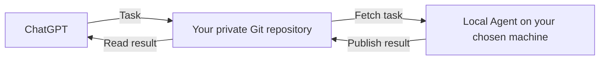
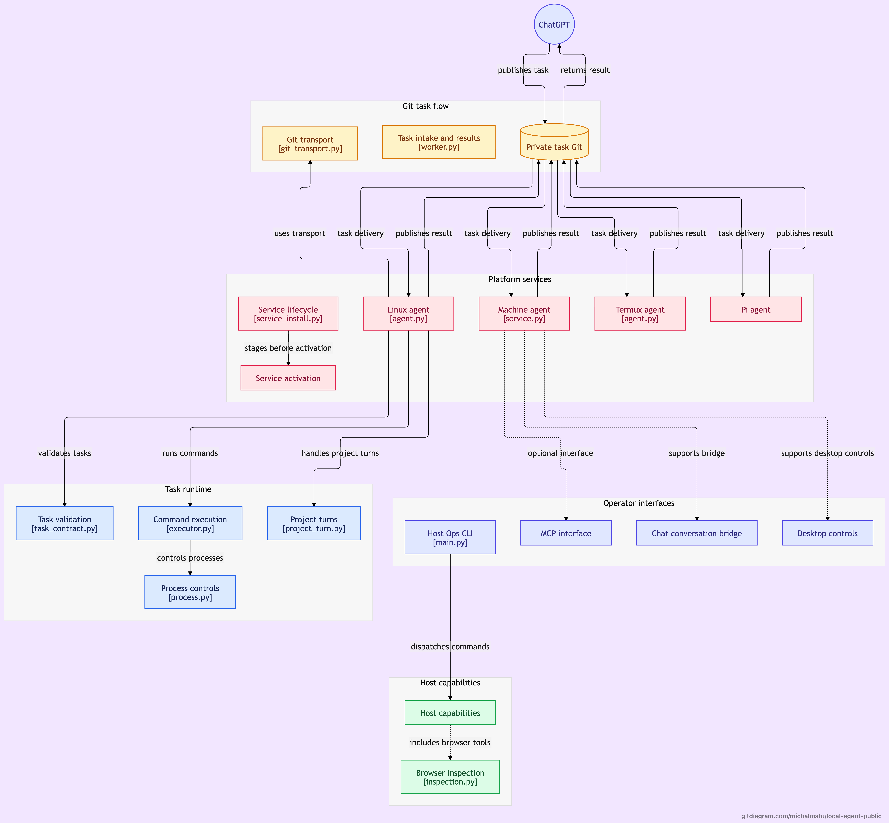

# Local Agent

## [☕ ☕ ☕ Buy me a coffee ☕ ☕ ☕](https://buymeacoffee.com/michalmatuh)

**Run tasks on your own machines from ChatGPT, using private Git.**

Local Agent is a small service you install on a computer you control.
Ask for a task, choose the machine, and get a recorded result back.
Use the tools, files and project environments already available on that machine.

[Get started](INSTALL_WITH_CODEX.md) · [Examples](docs/USAGE.md) ·
[Supported platforms](docs/SUPPORT.md) · [Documentation](docs/README.md)

[](https://gitdiagram.com/michalmatu/local-agent-public?utm_source=readme&utm_medium=badge)

## A typical task

> “In Local Agent mode, run the tests for my project on my Mac and show me the failures.”

ChatGPT publishes the request to your private Git repository. The Local Agent
on the selected Mac runs the task and publishes its result. You can read the
output and outcome through the same Git connection.

Other uses include checking a Debian server, running a build with local tools,
or requesting diagnostics from a Raspberry Pi or a Termux device.
Each platform has its own [supported scope](docs/SUPPORT.md).

## How it works



You choose the exact machine. Each installation runs independently with its
own identity, task history and service. Projects are optional.

The public repository distributes source code. **Your commands and results
belong in your own private repository.**

[Explore the interactive code architecture on GitDiagram](https://gitdiagram.com/michalmatu/local-agent-public).

<details>
<summary>Preview the architecture diagram</summary>

[](https://gitdiagram.com/michalmatu/local-agent-public)

</details>

## Why Local Agent?

- **Use your own environment.** Work with local tools, files, repositories and devices.
- **Keep a durable record.** Tasks and results travel through Git, with local recovery state.
- **Recover carefully.** Retry delivery of saved results; uncertain command effects are never automatically replayed.
- **Control execution.** Time, output and resource bounds, process tracking and emergency STOP.
- **Choose the machine.** Independent installations with explicit targeting.

## Install with Codex

Open **Codex locally with terminal access** and paste this:

```text
Install Local Agent from https://github.com/MichalMatu/local-agent-public
on this computer. Read README.md, AGENTS.md and INSTALL_WITH_CODEX.md.
Use the stable release, my own private Git task/result repository, and
unique installation identities. Preserve any existing installation and files.
Finish by verifying the native service and a real harmless task/result.
Tell me what passed and what still needs my action.
```

Codex prepares and verifies the installation. The running Agent then operates
independently of Codex. You provide your GitHub sign-in and authorize your
private task repository. [Full installation guide](INSTALL_WITH_CODEX.md).

## Platforms

| Platform | Current scope |
| --- | --- |
| macOS / Apple Silicon | Native launchd service, host commands, Host Ops and optional projects |
| Debian 13 / x86-64 | User-systemd service and bounded command tasks |
| Raspberry Pi Zero 2 W / Debian ARM64 | Independent Linux service with Pi-specific limits |
| Android / Termux | App-private command service with runit; background endurance varies by device |

These profiles have native pilot evidence. A new machine still needs its own
installation check. Windows is not implemented; other platforms require
separate qualification. [Requirements and limits](docs/SUPPORT.md).

## Access and safety

Local Agent executes with its service user's OS permissions. **It is not a
sandbox.** Writers authorized to your private task repository are trusted to
publish commands. Keep credentials and sensitive output out of public Git.
Use [STOP and recovery](docs/OPERATIONS.md) when you need to pause execution.

## Learn more

- [First installation](INSTALL_WITH_CODEX.md)
- [Tasks and examples](docs/USAGE.md)
- [Operations and recovery](docs/OPERATIONS.md)
- [Security model](docs/SECURITY_MODEL.md)
- [Architecture](docs/ARCHITECTURE.md)
- [Contributing](CONTRIBUTING.md)

Local Agent **4.20.14** · [Apache-2.0](LICENSE)
